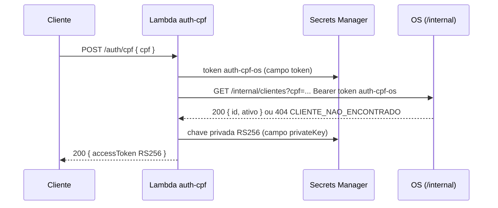

# Contrato `POST /auth/cpf`

## Request

```http
POST /auth/cpf
Content-Type: application/json
X-Correlation-Id: ignorado
```

```json
{
  "cpf": "529.982.247-25"
}
```

## Resposta de sucesso (`200`)

```json
{
  "accessToken": "<jwt>",
  "tokenType": "Bearer",
  "expiresIn": 3600
}
```

## Catálogo de erros

| HTTP | code | Quando |
| --- | --- | --- |
| 400 | `BODY_INVALIDO` | JSON malformado |
| 400 | `CPF_OBRIGATORIO` | Campo `cpf` ausente ou inválido |
| 400 | `CPF_INVALIDO` | CPF com dígitos verificadores inválidos ou sequência repetida |
| 401 | `NAO_AUTORIZADO` | Cliente inexistente **ou** inativo (mesma resposta) |
| 500 | `ERRO_INTERNO` | Falha interna |

## JWT de cliente

| Claim | Valor |
| --- | --- |
| `sub` | UUID do cliente |
| `tipo` | `CLIENTE` |
| `perfil` | `CLIENTE` |
| `iss` | `tech-challenge-auth` (configurável) |
| `aud` | `tech-challenge-api` (configurável) |
| `iat`, `exp` | Emitidos pelo emissor |
| `jti` | UUID único por token |

Algoritmo: **RS256**, assinado com a chave privada do segredo `JWT_SECRET_ARN` (campo `privateKey`). O OS valida com a chave pública (`JWT_PUBLIC_KEY`), exigindo algoritmo RS256, emissor, audiência, `tipo` e `perfil` `CLIENTE`. Expiração padrão: **1 hora**.

CPF, nome, e-mail e telefone **não** entram no token.

## Política de renovação

Não há refresh token. Token expirado exige nova autenticação por CPF.

Tokens já emitidos deixam de ser aceitos pela API quando o cliente é inativado (a Function não emite novos tokens; validação de ownership/perfil permanece na API).

## Rotação das chaves

A Function guarda só a chave privada (`JWT_SECRET_ARN`); o OS guarda o par, e Billing e Execution só a chave pública. A rotação é do par RS256 (procedimento no `infra-kubernetes`, `docs/segredos-rs256.md`). A Function mantém o segredo em cache até o próximo *cold start*: depois de gravar a nova versão, force a atualização da configuração da Lambda para renovar o cache.

## Fluxo de tokens e consulta ao OS



Dois tokens distintos:

| Token | Direção | Origem | Uso |
| --- | --- | --- | --- |
| `auth-cpf-os` | Lambda para OS | Segredo `AUTH_CPF_OS_TOKEN_ARN`, campo `token` | `Authorization: Bearer` na consulta interna; o OS compara com `TOKEN_AUTH_CPF_OS` |
| JWT de cliente | Lambda para cliente, depois cliente para OS | Assinado com `JWT_SECRET_ARN`, campo `privateKey` | `Authorization: Bearer` nas rotas `/v1` do OS |

### Rota do OS usada

`GET /internal/clientes?cpf={cpf}`. Contrato completo no `docs/contratos/rest-interno-os.md` do OS (`tech-challenge`).

| Item | Valor |
| --- | --- |
| Chamador | Lambda `auth-cpf` (relação `AUTH_CPF`) |
| `Idempotency-Key` | Não se aplica: é consulta (`GET`) |
| Cabeçalhos enviados | `Authorization: Bearer <token auth-cpf-os>`, `X-Request-Id` e `X-Correlation-Id` com o `awsRequestId` da invocação |
| 200 | `{ "id": "<uuid>", "ativo": true }` |
| 404 | `{ "codigo": "CLIENTE_NAO_ENCONTRADO", ... }`: cliente inexistente, a Lambda responde `401 NAO_AUTORIZADO` |
| 401/403 | Token `auth-cpf-os` recusado: falha de configuração, a Lambda responde `500 ERRO_INTERNO` |
| 5xx, timeout, rede | A Lambda responde `500 ERRO_INTERNO` |

Regras do adaptador (`src/shared/adapters/os-cliente.adapter.ts`):

- Timeout de **3 s** (`AbortController`). O login é síncrono para o cliente; o limite da Lambda é de 30 s. A consulta ao OS responde em dezenas de milissegundos, e 3 s cobre picos e deixa folga para a leitura do segredo e a assinatura.
- Um 404 sem o código `CLIENTE_NAO_ENCONTRADO` (rota ou URL base errada) **não** vira "cliente inexistente": é falha de resposta inválida e gera `500`, para não negar todos os logins em silêncio.
- CPF e token nunca entram em log nem em mensagem de erro. O CPF vai na query string, sem `Idempotency-Key`, e deve ser ofuscado no APM do OS.
- Sem acesso a banco: a Lambda não lê segredo de banco (D0.4).

## Identificador da requisição

Antes de existir uma OS não há `correlationId` de negócio (D7.2). Os logs e a métrica da `auth-cpf` usam o `awsRequestId` da invocação como `correlationId`, devolvido no header `X-Correlation-Id` da resposta e propagado ao OS em `X-Request-Id` e `X-Correlation-Id`. O `X-Correlation-Id` enviado pelo cliente é ignorado, porque o valor é controlado por quem chama. Falhas internas geram o log `auth_cpf_erro`, com o tipo do erro e o motivo (`timeout`, `acesso_negado`, `indisponivel`, `resposta_invalida`) e o status do OS, sem mensagem.

## Variáveis de runtime

| Variável | Obrigatória | Descrição |
| --- | --- | --- |
| `OS_SERVICE_BASE_URL` | sim | URL base do OS (NLB interno) |
| `AUTH_CPF_OS_TOKEN_ARN` | sim | Segredo do token `auth-cpf-os` (campo `token`) |
| `JWT_SECRET_ARN` | sim | Segredo da chave privada RS256 (campo `privateKey`; nome legado) |
| `JWT_ISSUER` | não | Default `tech-challenge-auth` |
| `JWT_AUDIENCE` | não | Default `tech-challenge-api` |
